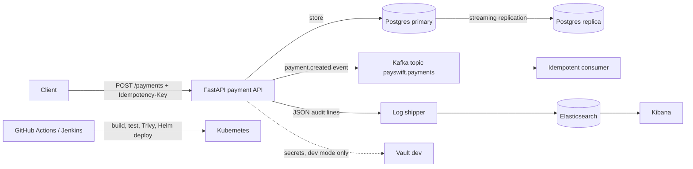

# PaySwift — Payment Gateway (PORTFOLIO SIMULATION)

> **SIMULATION — read this first.** This is a portfolio project built to
> learn and demonstrate DevOps + payment-system design. It is **not**
> company employment, **not** a real production payment gateway, and **no
> real money ever moves through it**. There are no real clients, no
> production incidents, and no production SLAs. Everything below says
> clearly what is real (code that runs and tests that pass) and what is
> simulated (design documents and local demos standing in for managed
> cloud services).

## What this project is

A small payment API (create payment → authorize → capture) built with a
production-shaped platform around it: Docker, Kubernetes/Helm, Jenkins
shared-library pipelines, GitHub Actions CI with Trivy scanning, Kafka
events, Vault (dev mode), an ELK-compatible audit trail, Postgres
primary/replica, and Terraform designs for EKS + RDS Multi-AZ.

## Architecture



## What each tool does, and WHY

| Tool | What it does here | Why it is here |
| --- | --- | --- |
| FastAPI | Payment API: create / authorize / capture, validation | Small, typed, testable; status flow mirrors real gateways |
| Idempotency keys | Same key + same payload = same payment, returned once | The exactly-once *effect*; without it a retry double-charges |
| Postgres primary/replica | Durable store + streaming standby | The local shape of RDS Multi-AZ; the failover demo target |
| Kafka | `payment.created` events, at-least-once | Downstream systems (audit, notifications) must not block payments |
| Vault (dev mode) | Secret store shape, demo token only | Shows the integration point; dev mode is never for real secrets |
| Elasticsearch + Kibana + shipper | Searchable audit trail | Lightweight ELK-compatible pipeline; full Logstash skipped to keep local runs light |
| Docker Compose | Whole stack on one machine | The runnable path: no cloud account needed |
| Kubernetes + Helm | Deployment manifests + chart | Same app, deployable to any cluster (kind locally) |
| Jenkins shared library | build / test / scan / helm-deploy steps | Pipelines as reusable code, not copy-pasted jobs |
| GitHub Actions + Trivy | Test, build, image scan (report-only) | Scan reports findings; it does not fail the build (remaining bookworm OS findings have no available fix) |
| Terraform (EKS + RDS) | Cloud design, **NOT APPLIED** | Shows the target architecture; applying it costs real money |

## What is real vs what is simulated

| Pasted claim | Honest status in this repo |
| --- | --- |
| "AWS EKS" | Terraform code defines an EKS cluster. **Not applied, no cluster exists.** Runnable path is Compose / kind. |
| "Jenkins shared-library pipelines with Helm" | Real: `vars/` steps + Jenkinsfile + Helm chart. Jenkins itself is not running here; CI equivalent runs in GitHub Actions. |
| "Kafka event streaming with idempotency keys for exactly-once" | Real, with a correction: the API's idempotency key gives an exactly-once *effect* (duplicate submits = one transaction, tested). Kafka itself is at-least-once; the consumer is idempotent. Never claim Kafka alone gives exactly-once. |
| "RDS Multi-AZ" | Terraform defines Multi-AZ RDS. **Not applied.** Local equivalent: Postgres primary + streaming replica in Compose. |
| "Vault secrets management" | Real locally in **dev mode only** (demo token, in-memory). Not a real secret store. |
| "ELK audit logs" | Real locally as Elasticsearch + Kibana + small shipper (no full Logstash). App writes real JSON audit lines. |
| "Cross-region disaster recovery" | **Design + runbook only** (`docs/dr-runbook.md`). No second region exists. |
| "RDS failover under 2 minutes, zero lost transactions" | **Local demo, not a production event.** `scripts/failover_demo.sh` stops the primary, promotes the replica, counts rows before/after, and prints its own measured time. The "under 2 minutes" figure is a design goal; the demo reports what it actually measured. |

## Step-by-step: run it locally

### 0. Requirements

Docker + Docker Compose on your machine, and Python 3.12 if you want to
run the tests without Docker. No AWS account, no cloud credentials.

### 1. Start the stack

```bash
cp .env.example .env
docker compose up --build
```

Services: API on http://localhost:8000, Vault on :8200 (dev mode),
Kibana on :5601, Elasticsearch on :9200, Kafka on :9092.

### 2. Run the tests (no Docker needed)

```bash
python -m venv .venv && . .venv/bin/activate
pip install -r requirements.txt -r requirements-dev.txt
pytest -v
```

### 3. Try the API

```bash
# Health
curl http://localhost:8000/health

# Create a payment (note the Idempotency-Key header)
curl -X POST http://localhost:8000/payments \
  -H "Content-Type: application/json" \
  -H "Idempotency-Key: demo-key-001" \
  -d '{"amount": 499.0, "currency": "INR", "payer": "demo-customer", "payee": "demo-merchant"}'

# Authorize, then capture (replace PAY_ID with the id returned above)
curl -X POST http://localhost:8000/payments/PAY_ID/authorize
curl -X POST http://localhost:8000/payments/PAY_ID/capture
curl http://localhost:8000/payments/PAY_ID
```

### 4. Idempotency demo (the exactly-once effect)

```bash
# Send the SAME request twice with the SAME key:
curl -X POST http://localhost:8000/payments \
  -H "Idempotency-Key: demo-key-001" \
  -d '{"amount": 499.0, "currency": "INR", "payer": "demo-customer", "payee": "demo-merchant"}'
# Second response: HTTP 200, header X-Idempotent-Replay: true,
# SAME payment id. GET /payments shows exactly one payment.

# Same key, DIFFERENT amount -> HTTP 409. Key reuse with changed
# payload is a client bug and must never silently overwrite a payment.
```

### 5. Failover demo (the simulated RDS failover)

```bash
bash scripts/failover_demo.sh
```

It prints row counts before/after and its own measured wall-clock time.
Reset afterwards with `docker compose down -v && docker compose up`.

### 6. Kubernetes path (kind, local)

```bash
# Build the image into kind, then apply manifests or the chart:
kind load docker-image payswift-api:local
kubectl apply -f k8s/
# — or —
helm upgrade --install payswift ./helm/payswift
kubectl port-forward svc/payswift-api 8000:80
curl http://localhost:8000/health
```

### 7. See the audit trail in Kibana

Open http://localhost:5601 → Discover → index pattern `payswift-audit*`.
Every `payment.created / authorized / captured` event is one JSON line.

## INTERVIEW SECTION — how to explain this project

### 60-second spoken explanation

> "PaySwift is a portfolio simulation of a payment gateway I built to
> learn payment-system design end to end. The API is FastAPI: a client
> creates a payment, then it moves from created to authorized to
> captured. The part I am most careful about is idempotency — if a
> client retries with the same idempotency key, it gets the original
> payment back, not a second charge, and I have tests proving that. On
> creation the API publishes a payment-created event to Kafka, but I
> kept that best-effort so a broker outage never fails a payment, and
> the consumer is idempotent because Kafka is at-least-once. Around it
> I built the platform: Docker Compose locally, Postgres primary and
> replica with a scripted failover demo, Vault in dev mode, audit logs
> shipped to Elasticsearch and Kibana, Helm and Kubernetes manifests, a
> Jenkins shared library, and GitHub Actions with Trivy scanning. The
> AWS side — EKS and RDS Multi-AZ — exists as Terraform code, not as
> provisioned infrastructure, because I did not want to run up cloud
> costs for a portfolio project. If I built it for real, the first
> things I would change are managed RDS with tested failover, managed
> Kafka with exactly-once settings on both sides, and Vault with
> short-lived tokens instead of dev mode."

### 10 likely interview questions, with honest answers

1. **Is this a real production system?**
   No. It is a portfolio simulation. The API, tests, Compose stack,
   Helm chart, and pipelines are real and runnable; EKS, RDS Multi-AZ,
   and cross-region DR are designs, not provisioned services.
2. **How do you prevent double-charging on retries?**
   The client sends an `Idempotency-Key` header. The server stores the
   key with the payment id and a hash of the payload. A replay returns
   the original payment; a reused key with a different payload gets
   409. The Postgres table has a UNIQUE constraint on the key.
3. **Does Kafka give you exactly-once?**
   No — Kafka gives at-least-once. Exactly-once *effect* comes from the
   idempotency key plus an idempotent consumer that ignores redelivered
   payment ids. Claiming Kafka alone gives exactly-once would be wrong.
4. **What happens if Kafka is down?**
   Nothing happens to the payment. Publishing is best-effort and its
   failure is logged; the API still returns 201. There is a test
   proving this.
5. **How does the failover demo work, and what does it prove?**
   Primary + streaming replica in Compose. The script counts rows,
   stops the primary, promotes the replica, counts again, and prints
   its measured time. It proves the *shape* works locally; it does not
   prove an RDS failover time or SLA.
6. **Why is Vault in dev mode?**
   Because this is a local demo. Dev mode is in-memory with a demo
   token. For real use I would run Vault properly with AppRole and
   short-lived tokens, and never commit a token.
7. **Why Elasticsearch + Kibana without Logstash?**
   To keep the local stack light. A small shipper tails the audit log
   into Elasticsearch; the audit lines and the Kibana view are the
   same. For real scale I would use a proper pipeline (Beats/Logstash
   or a managed service).
8. **What would break first under real traffic?**
   The in-memory store (when no database URL is set) and the single
   Kafka broker. Real deployment means Postgres with connection
   pooling, a multi-broker Kafka cluster, and horizontal API replicas
   behind a load balancer.
9. **How do you keep secrets out of the repo?**
   No AWS keys, tokens, or real passwords anywhere (see the secret
   scan in verification). Compose uses a local demo password from
   `.env`, which is git-ignored; Terraform marks the DB password
   sensitive and expects it via environment.
10. **What would you do differently in real production?**
    Managed RDS Multi-AZ with failover tested in staging and measured
    over many runs; managed Kafka with idempotent producer + consumer;
    real Vault; tested restores (an untested backup is not a backup);
    and proper observability (metrics, alerts, SLOs) instead of logs
    alone.
